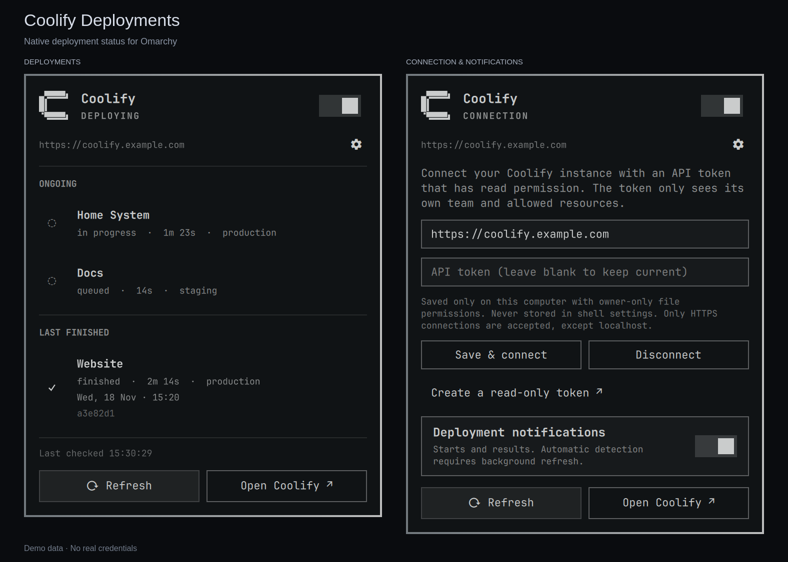

# Coolify Deployments for Omarchy

Ongoing and last finished Coolify deployments in your Omarchy bar, with desktop notifications when a deployment starts, succeeds or fails.



## Install

```sh
omarchy plugin add https://github.com/peterszarvas94/omarchy-coolify.git --enable
```

Nothing else to install. The plugin is plain QML and runs inside the Omarchy shell.

## Connect

1. Click the Coolify icon in the bar.
2. Enter your Coolify URL, such as `https://coolify.example.com`, or `https://app.coolify.io` for Coolify Cloud.
3. In Coolify, enable API access and create a token with **read** permission under **Keys & Tokens → API tokens**. Paste it and select **Save & connect**.

The token is saved in `~/.config/omarchy-coolify/connection.json`, readable only by you, and is sent only to the URL you entered. HTTPS is required, except on localhost.

## Use

- Click a deployment to open it in Coolify. Middle-click the bar icon to refresh.
- The header switch turns background refresh on or off: every 30 seconds, or every 5 seconds while deploying.
- Turn notifications off in the connection settings.
- To watch only some applications, list their UUIDs, comma-separated, in the widget settings.

Only application deployments are tracked. Coolify services and databases have no deployment history.

## Update and remove

```sh
omarchy plugin update io.github.peterszarvas94.coolify
omarchy plugin remove io.github.peterszarvas94.coolify
```

Select **Disconnect** before removing to delete the saved token, and revoke it in Coolify if you no longer need it.

## Development

```sh
omarchy plugin validate .
mkdir -p /tmp/omarchy-coolify-imports/qs
ln -sfn /usr/share/omarchy/shell/Commons /tmp/omarchy-coolify-imports/qs/Commons
ln -sfn /usr/share/omarchy/shell/Ui /tmp/omarchy-coolify-imports/qs/Ui
/usr/lib/qt6/bin/qmllint --missing-property info -I /tmp/omarchy-coolify-imports -I /usr/lib/qt6/qml *.qml
```

Copy the checkout into `~/.config/omarchy/plugins/io.github.peterszarvas94.coolify` and run `omarchy restart shell` to try changes.

## License

MIT. The Coolify mark is under Apache-2.0; see `assets/`. Not affiliated with or endorsed by Coolify.
