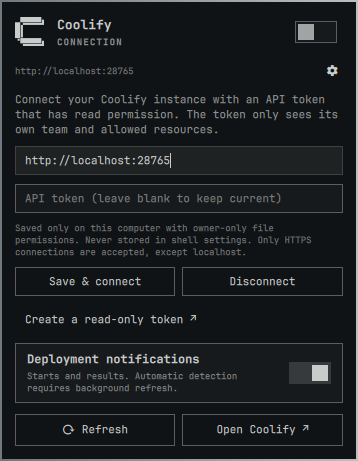

# Deployment notifications

Verified on Asimov in an isolated headless Sway compositor with its own Wayland socket and private D-Bus session. The preview loaded the real Omarchy notification service with its state redirected into the test directory. The fixture API used demo data only. The notification action handler was replaced with a URL capture command, so no real browser or user desktop was controlled.

The checks covered:

- Silent initial baseline, then queued → running → succeeded.
- Failed and cancelled result notifications, with native urgency and duration.
- Repeated results producing no duplicate card.
- The notification's default click action opening the expected deployment URL in the test handler.
- Omarchy Do Not Disturb suppressing a normal-priority start notification.
- Connection settings showing an independent notification preference while keeping the header refresh switch unchanged.

Go tests also cover concurrent monitor deduplication, reconnection baselines, disabled/re-enabled notifications, multiple recent completions, markup-shaped names, credential-free history and owner-only history file permissions. No frontend tests were added.

