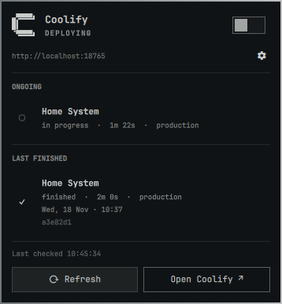
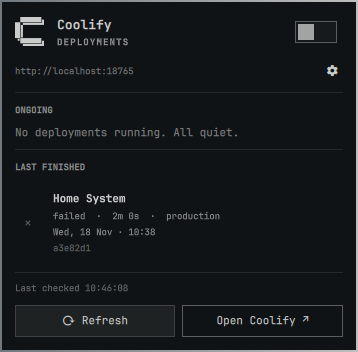
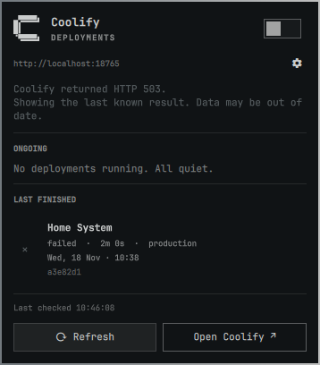
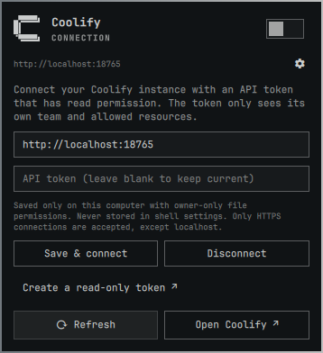
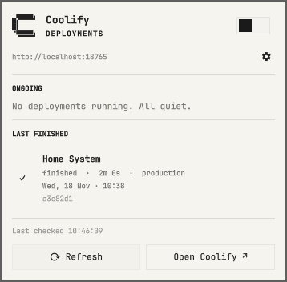
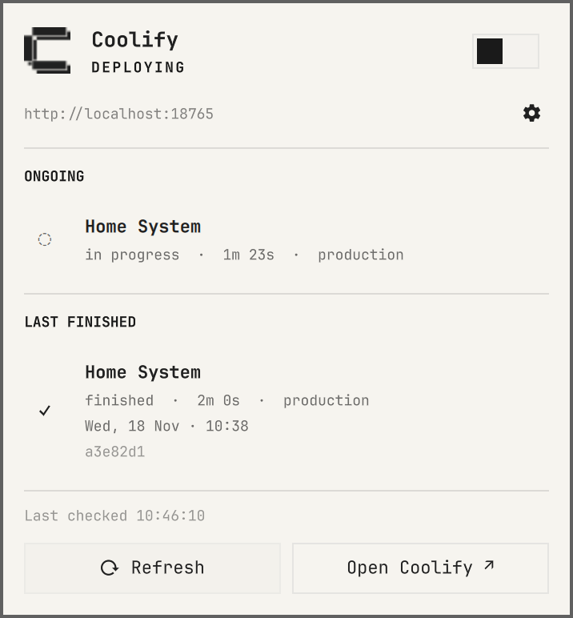

# Verification

Verified on 2026-11-18. Final UI checks ran on Asimov in a separate headless Sway compositor with its own Wayland socket, virtual input and temporary XDG configuration. Quickshell loaded the actual plugin source and Omarchy's installed `Commons` and `Ui` components. The user's physical desktop and production credential file were not used by this preview.

A local, read-only Coolify-shaped API fixture supplied sample deployments. These screenshots contain demo data only. The real connection was separately checked on the workstation before testing moved to Asimov: authentication succeeded, no deployment was running, and the last finished result matched Bandcash production. No deployment was triggered.

## Visual checks

- Coolify mark and active count fit the native bar slot.
- Header, separators, input fields and footer share their expected panel insets.
- Background refresh uses the top-right header switch; the connection gear aligns with the instance URL. The boxed deployment count and large refresh settings row are removed.
- Refresh/Open Coolify have equal widths and heights. Connection action buttons have equal widths when both are present.
- Footer actions stay visible while long content scrolls.
- Setup, running, idle, failed and disconnected states render without plugin QML runtime errors.
- Light/dark palettes and scale 1/2 render correctly. The light palette was changed only inside the isolated preview process.
- Disconnection preserves the previous result and shows an explicit stale-data message.

## Local checks

- `go test -race ./...` passed, covering private file permissions, URL validation, bearer authentication, application filtering with duplicate names and omitted IDs, completion ordering, deployment links, API errors, redirects and both global queue response shapes.
- `go vet ./...`, `bash -n bin/coolify-status`, plugin manifest validation and `git diff --check` passed.
- `qmllint` found no syntax/import errors with the host modules mapped under `qs`. It reports the host's dynamic `Style.font` and `bar.shell` members as unknown; the actual Quickshell preview resolves these correctly.
- No frontend tests or CI configuration were added.

## Scope

The isolated preview checks rendering against real Omarchy components, not a complete logged-in Hyprland session. Bar placement and live authentication were checked on the workstation earlier; the final alignment refinements were checked remotely. No automated input is sent to the user's desktop.
